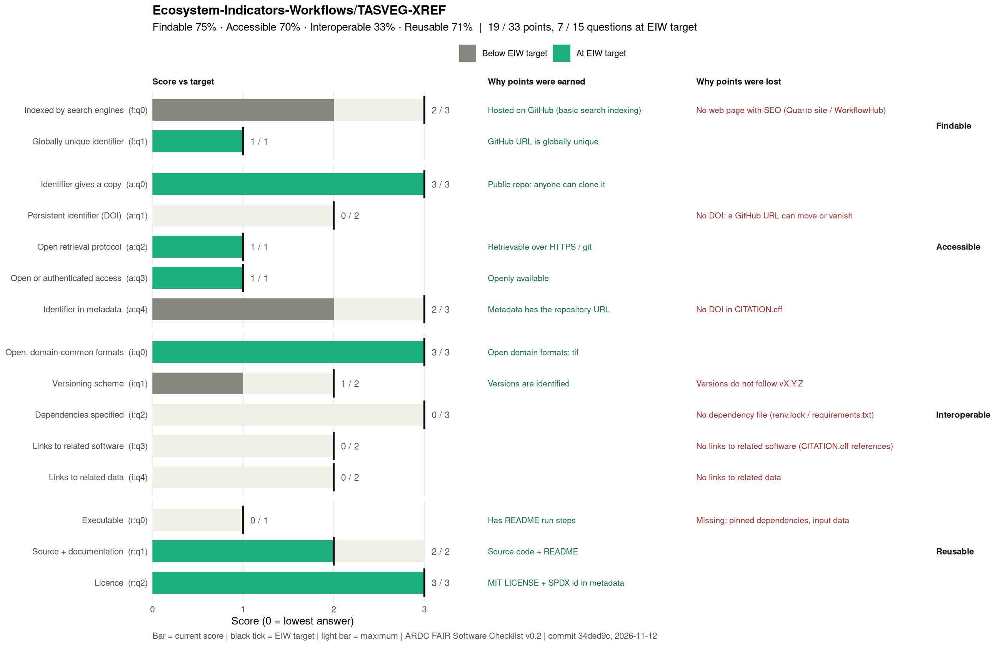

# Cross-referencing Tasmanian Terrestrial Ecosystems (TASVEG-XREF)
A reproducible workflow that cross-references the 159 mapping units of TASVEG 5.0, Tasmania’s vegetation map, to the ecosystem functional groups of the IUCN Global Ecosystem Typology (GET).

Five expert interpreters assigned each TASVEG unit to IUCN GET units over two rounds. This workflow cleans and validates their membership tables, measures how well the interpreters agree and how uncertain each assignment is, then summarises and maps the results. The whole workflow is written as a Quarto book.

It is a joint output of the ARDC Ecosystem Indicators Workflows (EIW) project and the ARC Industry Laureate Fellowship Foundations for leading the nature positive ecosystem conservation agenda (IL240100030).

## Keywords
`#tasmania`, `#tasveg`, `#ecosystem-classification`, `#quarto`, `#r`, `#expert-elicitation`, `#ardc`.

## Requirements
- R ≥ 4.3, Quarto ≥ 1.4, and Jupyter with the R kernel (IRkernel) for the .ipynb chapters
- CRAN packages: here dplyr tidyr readr readxl stringr tibble rlang ggplot2 cowplot DT foreign sf terra fasterize units foreach IRkernel
- ecoSynthesis, installed with remotes::install_github("Ecosystem-Indicators-Workflows/ecoSynthesis")

## Input data

Expert membership tables are included in [`xrefdata/`](xrefdata/). TASVEG 5.0 is not included. Download and extract it from [theLIST Open Data](https://listdata.thelist.tas.gov.au/opendata/data/LIST_TASVEG_50_STATEWIDE.zip) (© State of Tasmania) under `gisdata/`, preserving this layout:

```text
gisdata/
├── LIST_TASVEG_50_STATEWIDE/
│   └── TASVEG_5_0.{shp,dbf,shx,prj}
└── TASVEG_5_0_Fire_Attributes_LUT.dbf

The workflow writes its outputs to output-XREFs/. That folder, along with gisdata/, is ignored by git.

## Running the workflow
From a terminal (Mac->Terminal;Windows->CMD), clone the repository and move into its folder:
```
git clone https://github.com/Ecosystem-Indicators-Workflows/TASVEG-XREF.git # this copies repository files to your local folder
cd TASVEG-XREF # we make sure we are in the the local folder once we have all files
quarto render #run files to lauch a html in your browser to view contents
```
The rendered book is written to _book/; open _book/index.html in a browser. Chapters build on outputs from earlier ones, so run them in the order listed in _quarto.yml.

## Running the workflow

From a terminal, clone the repository and move into its folder:

```bash
git clone https://github.com/Ecosystem-Indicators-Workflows/TASVEG-XREF.git
cd TASVEG-XREF
```

Render the Quarto book:

```bash
quarto render
```

The rendered book is written to `_book/`. Open `_book/index.html` in a browser to view it. The chapters are listed in `_quarto.yml` and use outputs from earlier workflow stages.

### Reproduce the TASVEG output files

To regenerate the data products, run the scripts from the repository root. If the TASVEG source data is not already available in `gisdata/`, download it first. The download script requires `wget`.

```bash
R --vanilla < inc/TASVEG-data-download.R \
  > reproducibility-notes/TASVEG-data-download-out.txt

R --vanilla < inc/TASVEG-xref-IUCNGET-output-best-90m.R \
  > reproducibility-notes/TASVEG-xref-IUCNGET-output-best-90m-out.txt
```

The script writes the files to `output-best-candidate/`. To regenerate the dataset README after the outputs are created:

```bash
quarto render output-best-candidate/README.qmd
```

See the [output-generation script](https://github.com/Ecosystem-Indicators-Workflows/TASVEG-XREF/blob/main/inc/TASVEG-xref-IUCNGET-output-best-90m.R) and [R reproducibility notes](https://github.com/Ecosystem-Indicators-Workflows/TASVEG-XREF/blob/main/reproducibility-notes/reproducibility-R.qmd) for details.

## Publish the book to GitHub Pages

From the repository root, run:
```bash
quarto publish gh-pages
```

## Output files

| File | Format | Contents |
|---|---|---|
| `TASVEG-xref-target.tiff` | GeoTIFF | Best-candidate IUCN GET ecosystem functional group |
| `TASVEG-xref-membership.tiff` | GeoTIFF | Membership weight for the selected group |
| `TASVEG-xref-supporting.tiff` | GeoTIFF | Number of interpreters supporting the selected group |
| `TASVEG-xref-best-candidate.csv` | CSV | TASVEG-to-IUCN GET best-candidate cross-reference |
| `IUCN-GET-pixel-lookup.csv` | CSV | Pixel value, ecosystem group, name, and colour lookup |
| `TASVEG-xref-target.clr` | CLR | Colour map and labels for the target raster |

### Read the outputs in R

```r
library(terra)
library(readr)

output_dir <- "output-best-candidate"

r_target <- rast(file.path(output_dir, "TASVEG-xref-target.tiff"))
r_memb <- rast(file.path(output_dir, "TASVEG-xref-membership.tiff"))
r_supp <- rast(file.path(output_dir, "TASVEG-xref-supporting.tiff"))

lookup <- read_csv(
  file.path(output_dir, "IUCN-GET-pixel-lookup.csv"),
  show_col_types = FALSE
)

xref <- read_csv(
  file.path(output_dir, "TASVEG-xref-best-candidate.csv"),
  show_col_types = FALSE
)

# Attach ecosystem group codes and names to the categorical raster.
levels(r_target) <- data.frame(
  id = lookup$efg_pixel_value,
  EFG = lookup$EFG,
  efg_name = lookup$efg_name
)

plot(r_target, main = "Best-candidate IUCN GET group")

# Keep cells with membership >= 0.8 and support from all five interpreters.
high_confidence <- (r_memb >= 0.8) & (r_supp == 5)
r_target_high_confidence <- mask(
  r_target,
  high_confidence,
  maskvalues = 0
)

plot(
  r_target_high_confidence,
  main = "High-confidence best-candidate groups"
)
```

### Read the outputs in Python

```python
import numpy as np
import pandas as pd
import rasterio

output_dir = "output-best-candidate"

lookup = pd.read_csv(f"{output_dir}/IUCN-GET-pixel-lookup.csv")
xref = pd.read_csv(f"{output_dir}/TASVEG-xref-best-candidate.csv")

with (
    rasterio.open(f"{output_dir}/TASVEG-xref-target.tiff") as target,
    rasterio.open(f"{output_dir}/TASVEG-xref-membership.tiff") as membership,
    rasterio.open(f"{output_dir}/TASVEG-xref-supporting.tiff") as supporting,
):
    target_arr = target.read(1)
    membership_arr = membership.read(1)
    supporting_arr = supporting.read(1)

    crs = target.crs
    transform = target.transform

# Example mask: membership >= 0.8 and support from all five interpreters.
high_confidence = (membership_arr >= 0.8) & (supporting_arr == 5)
target_high_confidence = np.where(high_confidence, target_arr, np.nan)
```

## Fair Check
What it does:
- Assesses a workflow repository against the ARDC FAIR Software Checklist v0.2 and EIW’s target scores.
- Scores 15 questions across Findable, Accessible, Interoperable, and Reusable.
- Reports evidence for points earned and specific gaps to address.

How it works:
- The R script checks repository evidence such as tracked files, README instructions, licences, Git tags, data formats, dependency files, and citation metadata.
- A YAML settings file supplies details that the script can’t reliably detect, such as output formats, whether input data is included, and any evidence overrides.
- It compares each current score with the EIW target and totals the results by FAIR principle.
- It generates a score chart and JSON report, and updates the README section between `!-- FAIR:START --` and `!-- FAIR:END --`.
- A GitHub Actions workflow runs the check when changes are pushed to main or when manually triggered.

<!-- FAIR:START -->
## FAIR assessment

[](https://fairsoftwarechecklist.net/v0.2?f=21&a=30112&i=31000&r=023) 

**19 / 33 points · 7 / 15 questions at EIW target** · not yet at EIW minimum

| Principle | Score | EIW target |
|---|---|---|
| Findable | 3 / 4 (75%) | 4 / 4 |
| Accessible | 7 / 10 (70%) | 10 / 10 |
| Interoperable | 4 / 12 (33%) | 12 / 12 |
| Reusable | 5 / 7 (71%) | 6 / 7 |

<details><summary>Gaps to close (8)</summary>

- **f:q0 Indexed by search engines** (2 / 3): No web page with SEO (Quarto site / WorkflowHub)
- **a:q1 Persistent identifier (DOI)** (0 / 2): No DOI: a GitHub URL can move or vanish
- **a:q4 Identifier in metadata** (2 / 3): No DOI in CITATION.cff
- **i:q1 Versioning scheme** (1 / 2): Versions do not follow vX.Y.Z
- **i:q2 Dependencies specified** (0 / 3): No dependency file (renv.lock / requirements.txt)
- **i:q3 Links to related software** (0 / 2): No links to related software (CITATION.cff references)
- **i:q4 Links to related data** (0 / 2): No links to related data
- **r:q0 Executable** (0 / 1): Missing: pinned dependencies, input data

</details>



<sub>Updated 2026-11-12 from commit `34ded9c` by `.fair/fair_check.R`. Edit `.fair/fair-checklist.yml`, not this block.</sub>
<!-- FAIR:END -->
