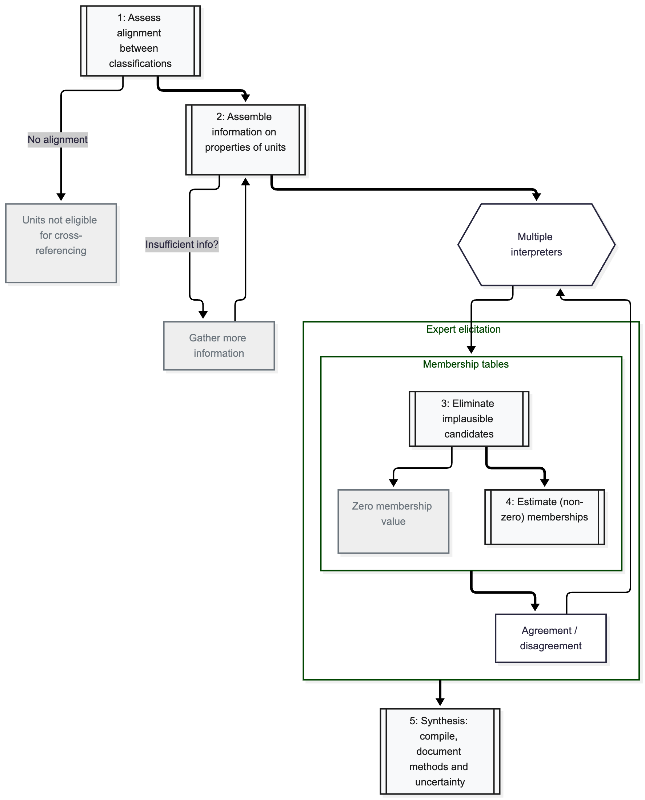

# Stepwise cross-referencing process {#sec-process}

The need to cross-reference different ecosystem classification systems arises frequently in ecological research, national ecosystem accounting, Red List of Ecosystems assessments, and conservation reporting. The conceptual foundations, standards, and diagnostic methods for cross-referencing classifications to the IUCN Global Ecosystem Typology (IUCN GET; @Keith_2022) are established in @IUCN_2025.

Here we apply consistent standards and reproducible computational methods so that relationships between classification units are explicit, auditable, and straightforward to update whenever new ecological evidence or updated spatial maps become available. Formalising the cross-referencing pipeline also minimises undocumented or divergent interpretations when local vegetation typologies are translated into global reporting frameworks [@DeCaceres_2012; @IUCN_2025].

Cross-referencing links a **source classification** to a **target classification**, where the target classification typically has a broader thematic or geographic scope than the source. Each unit in the source classification can relate directly to one or more units in the target classification. Following fuzzy set theory [@Zadeh_1965] and the IUCN guidelines [@IUCN_2025], this relationship is quantified using **fuzzy membership values** between 0 (0%, excluded) and 1 (100%, unambiguous assignment), summing to 1 across all assigned target units for a given source unit and interpreter.

Combining independent membership assessments from multiple domain experts—structured across iterative elicitation rounds with facilitated discussion between rounds—reduces linguistic ambiguity, guards against individual cognitive biases, and yields robust, transparent estimates of both consensus and residual thematic uncertainty [@Martin_2012; @Hemming_2018].

## Overview of the stepwise cross-referencing process

A five-step diagnostic process ensures that the cross-referencing exercise upholds four core principles: (1) conceptual alignment of classifications, (2) membership estimation based on entity properties, (3) weight of evidence, and (4) transparent representation of uncertainty [@IUCN_2025].

{#fig-process}

- **Steps 1 and 2** establish conceptual eligibility and assemble the ecological and spatial reference information that underpins all subsequent decisions.
- **Steps 3 and 4** involve multiple domain experts independently eliminating implausible target units and estimating non-zero fuzzy memberships. Conducting a second round of elicitation after structured group discussion (analogous to the Investigate–Discuss–Estimate–Aggregate, or IDEA, protocol; @Hemming_2018) typically involves:
  - gathering independent first-round expert contributions,
  - analysing inter-interpreter discrepancies, target usage, and uncertainty to guide structured discussion, and
  - collecting revised second-round contributions from each interpreter.
- **Step 5** synthesises the validated multi-interpreter membership tables into summary tables, spatial area estimates, and geospatial outputs, while documenting remaining sources of uncertainty.

## Reproducible computational workflow

This repository assists in the translation of parts of the conceptual process in @fig-process into a reproducible computational workflow. 

:::{.aside}
While the computation workflow is reproducible for correctly formatted input data, we stress that these steps cannot be decoupled from the expert elicitation process. Ultimately all inputs and outputs have to be checked and reviewed by the human expert with the ecosystem specific knowledge to make correct decisions and interpretations.
:::

The workflow takes raw interpreter spreadsheets (`xrefdata/`) and authoritative TASVEG 5.0 spatial data (`gisdata/`), executes validation and analysis steps transparently in R, and produces versioned, FAIR-aligned data products [@Wilkinson_2016; @Barker_2022].

We build on the [`ecoSynthesis`](https://github.com/Ecosystem-Indicators-Workflows/ecoSynthesis) R package [@ecoSynthesis_pkg]—currently under active development—together with repository-specific helper functions in `scripts/functions.R` and standard spatial/tidyverse packages. Throughout this book, explicit call-out notes highlight where package functions and repository helpers overlap or differ, explaining which implementation is preferred at each step.

To keep documentation rendering fast and modular, the **analytical Quarto workflow** (`docs-src/`) is kept separate from the **standalone output-generation scripts** (`scripts/`), which perform computationally heavier tasks such as 90 m rasterisation (`fasterize`) and statewide GeoPackage assembly (see @sec-outputs).

Within the analytical workflow, we distinguish two main computational stages: (1) **Data preparation, validation, and exploration**, and (2) **Analysis and synthesis** (see @fig-userjourney).

```{mermaid}
%%| label: fig-userjourney
%%| fig-cap: "Computational stages of the cross-referencing workflow from data preparation to analysis and synthesis."
flowchart TB
    PREP["Data Preparation:<br/>importing, joining, filtering, modifying datasets "]:::Tasks
    VALID{"Data<br/>Validation"}:::Tasks
    EXP[Exploration:<br/> Interpreters, rounds, membership values]:::Tasks
    NINT{"Two rounds"}:::Tasks

    ELI1[Within round<br/>agreement & entropy]:::Tasks
    ELI2[Within round<br/>agreement & entropy]:::Tasks
    ELI3["Between rounds<br/>agreement & entropy metrics"]:::Tasks
    SYNT[Synthesis & outputs]:::Tasks

    subgraph FIRST["Data preparation and exploration"]
        direction LR
        PREP --> VALID
        VALID -->|no| PREP
        VALID -->|yes| EXP
    end
    FIRST:::Steps --> SECOND:::Steps
    subgraph SECOND["Analysis and synthesis"]
        direction LR
        NINT -->|"Round 1"| ELI1 --> ELI3
        NINT -->|"Round 2"| ELI2 --> ELI3
        ELI2 --> SYNT
    end

    classDef Tasks fill:#fff,stroke:#90853E,color:#2d5a27,stroke-width:2px
    classDef Steps fill:#fff,stroke:#853E90,color:#853E90,stroke-width:1px
```

## Structure of this document

- **Preliminaries**: Source classification overview (@sec-source) and conceptual alignment to IUCN GET (@sec-alignment).
- **Part I — Preparation**: Lookup tables (@sec-lookup), reading heterogeneous membership tables (@sec-input-memb), validation and cleaning (@sec-valid), and initial data exploration (@sec-exploration).
- **Part II — Analysis**: Within-round agreement, target usage, and Shannon's entropy for Round 1 (@sec-round-one) and Round 2 (@sec-round-two), followed by between-round comparisons (@sec-between-rounds).
- **Part III — Synthesis**: Membership synthesis strategies (@sec-synthesis), unweighted and weighted area summaries (@sec-areas), and spatial output concepts (@sec-maps).
- **Appendices**: Glossary, membership table formats (@sec-formats), R reproducibility and benchmarking notes (@sec-reproducibility), and the status overview of all repository outputs (@sec-outputs).
