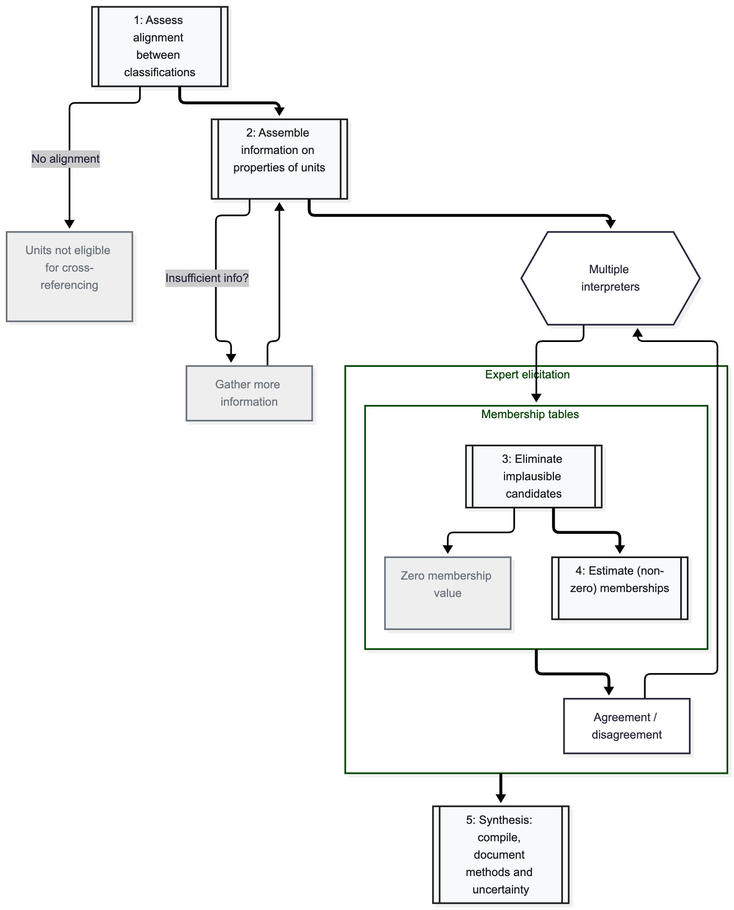

The need to cross-reference different classification systems arises frequently in ecology and conservation applications. The conceptual foundations for cross-referencing classifications are discussed in @IUCN_2025.

Here we try to apply consistent methods and standards for cross-referencing in order to make the relationships between units more explicit and enhance the reproducibility of the process. This will enable efficient update when more information becomes available, and minimise divergent or erroneous interpretations of relationships between classifications. 

The process of cross-reference involves a source classification and  a target classification, where the target classification might have a broader scope than the source. Elements in the source classification  can be interpreted as directly related to one or more elements in the  target classification. This relationship can be quantified as membership values, where the source element has memberships between 0 and 100% to each element of the target classification. 

Membership estimates from multiple interpreters can be combined to produce more robust cross-referencing relationships. Uncertainty due to disagreements between interpreters can be quantified and documented for maximum transparency.

## Overview of stepwise cross-referencing process

A stepwise diagnostic process ensures that the cross-referencing exercise aligns with four key principles: alignment of classifications, membership based on entity properties, using weight of evidence, and transparent representation of uncertainty [@IUCN_2025].

{label=fig-process}

Steps 1 and 2 are essential steps for preparation of the information and decisions that will shape the cross-referencing process. Multiple interpreters might be involved in steps 3 and 4. An additional round of expert elicitation is recommended to try to reduce disagreement. 

The process of expert elicitation usually involves:

- gathering individual experts contributions,
- analysis of discrepancy and agreement: discussion,
- and revised individuals contributions. 

In step 5 we are interested in compiling membership matrix from multiple interpreters after the elicitation process, linking back to spatial data for visualisation, and documenting and analysing sources of uncertainties.

## Reproducible workflow for cross-referencing

In this document we want to translate the cross-referencing process into a reproducible computation workflow. This computation workflow will take inputs from the interpreters, and describe all steps of data preparation and analysis that lead to specific outputs. The purpose of the workflow is to increase reproducibility of this process that will allow streamlined updates of outputs everytime the input data is updated.

For this process we lean on the R package `ecoSynthesis` currently under development, as well as on custom scripts and functions, and additional R packages.

For this workflow we distinguish two main stages of the cross-referencing process. The first is dedicated to data preparation, validation and exploration. The second is dedicated to analysis and synthesis. See @fig-userjourney for an overview.

```{mermaid}
%%| label: fig-userjourney
%%| fig-cap: "Steps of the user journey."
flowchart TB
    PREP["Data Preparation:<br/>importing, joining, filtering, modifying datasets "]:::Tasks
    VALID{"Data<br/>Validation"}:::Tasks
    EXP[Exploration:<br/> Interpreters, rounds, membership values]:::Tasks
    NINT{"Two rounds"}:::Tasks

    ELI1[Within round<br/>agreement & entropy]:::Tasks
    ELI2[Within round<br/>agreement & entropy]:::Tasks
    ELI3["Between rounds<br/>entropy metrics"]:::Tasks
    SYNT[Synthesis & outputs]:::Tasks

    subgraph FIRST["Data preparation and exploration"]
        direction LR
        PREP --> VALID
        VALID -->|no| PREP
        VALID -->|yes| EXP 
    end
    FIRST:::Steps --> SECOND:::Steps
    subgraph SECOND["Analysis and synthesis"]
        direction LR
        NINT -->|"Round 1"| ELI1 --> ELI3 
        NINT -->|"Round 2"| ELI2 --> ELI3 
        ELI2 --> SYNT
    end
    
    classDef Tasks fill:#fff,stroke:#90853E,color:#53E908,stroke-width:2px
    classDef Steps fill:#fff,stroke:#853E90,color:#853E90,stroke-width:1px
```

## Structure of this document

We address the source classification in @sec-source and the alignment to the target classification in @sec-alignment.

We then document the different tasks of data preparation in @sec-lookup and @sec-input-memb; data validation in @sec-valid; and data exploration in @sec-exploration. 

We then document the analysis stage in three separate tasks: analysis of the first round in @sec-round-one; analysis of the second round in @sec-round-two; and the comparison between rounds in @sec-inter-round.

Finally we summarise the synthesis and outputs in @sec-synthesis.

