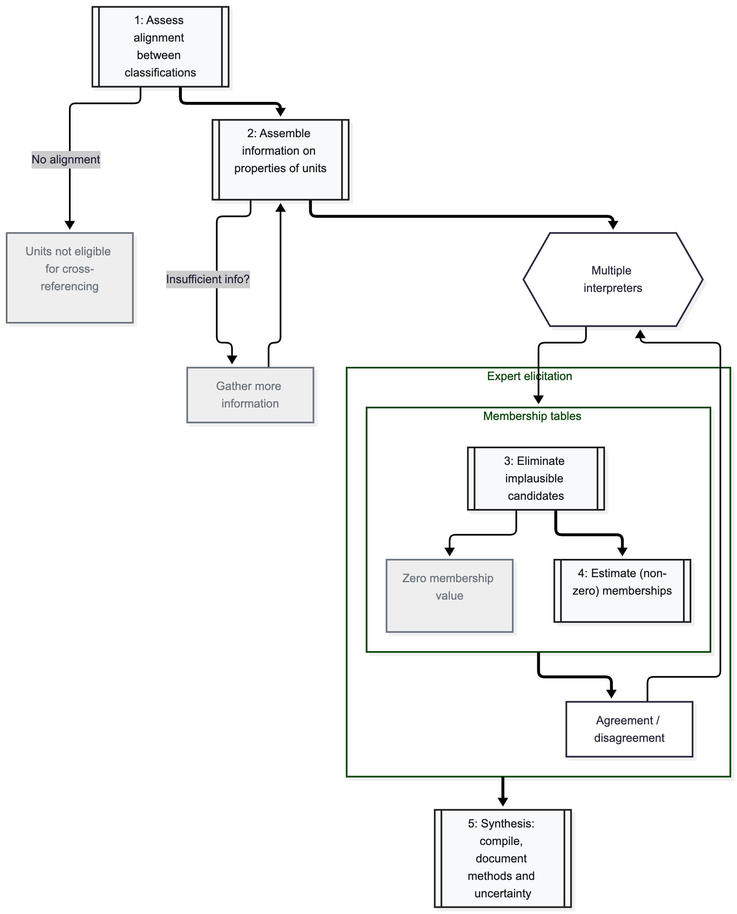

The need to cross-reference different classification systems arises frequently in ecology and conservation applications. The conceptual foundations for cross-referencing classifications are discussed in @IUCN_2025.

Here we try to apply consistent methods and standards for cross-referencing in order to make the relationships between units more explicit and enhance the reproducibility of the process. This will enable efficient update when more information becomes available, and minimise divergent or erroneous interpretations of relationships between classifications. 

The process of cross-reference involves a source classification and 
a target classification, where the target classification might have
a broader scope than the source. Elements in the source classification 
can be interpreted as directly related to one or more elements in the 
target classification. This relationship can be quantified as membership
values, where the source element has memberships between 0 and 100% to each
element of the target classification. 

Membership estimates from multiple interpreters can be combined to produce more robust cross-referencing relationships. Uncertainty due to disagreements between interpreters can be quantified and documented for maximum transparency.

## Overview of stepwise cross-referencing process

A stepwise diagnostic process ensures that the cross-referencing exercise aligns with four key principles: alignment of classifications, membership based on entity properties, using weight of evidence, and transparent representation of uncertainty [@IUCN_2025].

Steps 1 and 2 are essential steps for preparation of the information and decisions that will shape the cross-referencing process. 

:::{.aside}
We adress these two steps in [@sec-preparation].
:::

Multiple interpreters might be involved in steps 3 and 4. An additional round of expert elicitation is recommended to try to reduce disagreement. 

:::{.aside} 
We summarise the process of expert elicitation in @sec-elicitation.
:::

The process of expert elicitation usually involves:

- gathering individual experts contributions,
- analysis of discrepancy and agreement: discussion,
- and revised individuals contributions. 

In step 5 we are interested in compiling membership matrix from multiple interpreters after the elicitation process, linking back to spatial data for visualisation, and documenting and analysing sources of uncertainties.

:::{.aside} 
We summarise the results in @sec-synthesis.
:::

## Proposed functionality

We want to create general functions that will support users in each step:

- Input of individual contributions, harmonisation of data formats (steps 1 and 3)
- Visualisation and metrics of agreement and disagreement (step 2)
- Synthesis, including aggregation and uncertainty (step 4)
- Visualisation of crossref maps (steps 2 and 4)
- Query of crossref maps (steps 2 and 4)
